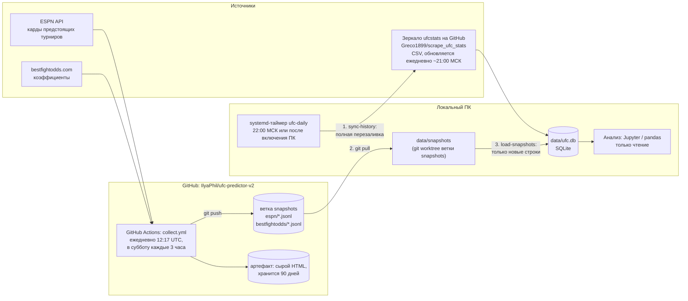

# Архитектура сбора данных

## Схема



## Почему так

Данные делятся на два вида, и для каждого свой способ сбора:

| | История (бои, статистика, профили) | Снимки (кард, коэффициенты) |
|---|---|---|
| Можно получить задним числом? | **да** — зеркало хранит весь архив | **нет** — линия на конкретный момент потом недоступна |
| Чем грозит пропуск дня | ничем, следующий запуск догонит | потеря снимка навсегда |
| Где собирается | локально | в облаке (GitHub Actions), работает при выключенном ПК |
| Как пишется в БД | перезаливка целиком | дописывание, без дублей |

Сбор снимков (`collect`) не знает о БД — только пишет JSONL-файлы. Загрузка в БД
(`load-snapshots`) идемпотентна: первичный ключ включает время снимка, повторная загрузка
тех же файлов ничего не добавляет. Поэтому БД всегда можно пересобрать с нуля:
`rm data/ufc.db && python -m ufc.cli daily`.

## Источники

- **ufcstats.com** — официальная статистика UFC. Сам сайт закрыт JS-проверкой от ботов;
  обходить ее сознательно не стали. Берем ежедневную CSV-выгрузку стороннего репозитория
  [Greco1899/scrape_ufc_stats](https://github.com/Greco1899/scrape_ufc_stats) (GPL-3).
  Особенности выгрузки: в боях нет id бойцов (только имена) → сопоставление имен;
  бои Noche UFC продублированы под старым названием турнира → дедупликация по id боя.
- **ESPN** — `site.api.espn.com/apis/site/v2/sports/mma/ufc/scoreboard?dates=...`,
  публичный JSON без ключа. Турниры на 60 дней вперед.
- **bestfightodds.com** — `robots.txt` разрешает обход; пауза между запросами 3 с.
  Главная → список турниров UFC → страница турнира → moneyline по букмекерам.
  Запросы с серверов GitHub проходят (проверено 2026-10-27).

## Код

```
ufc/
  cli.py                 команды: sync-history, collect, load-snapshots, daily, check, status, unresolved
  config.py              пути, HISTORY_START (2001-01-01), SNAPSHOT_DIR (env UFC_SNAPSHOT_DIR)
  schema.sql             схема БД
  db.py                  подключение, журнал запусков sync_runs
  http.py                HTTP с паузами и повторами; сохранение сырых ответов в data/raw/
  names.py               сопоставление имен бойцов между источниками
  checks.py              проверки качества истории
  snapshots.py           запись/чтение JSONL-снимков и загрузка в БД
  sources/
    ufcstats_mirror.py   история из CSV-зеркала
    espn.py              карды
    bestfightodds.py     коэффициенты
data/
  ufc.db                 БД (не в git)
  raw/                   сырые ответы источников, .gz (не в git)
  snapshots/             рабочая папка ветки snapshots (git worktree)
  manual/                ручные справочники — в git
    fighter_aliases.csv  ручные сопоставления имен с обоснованием
deploy/systemd/          юниты таймера (копируются в ~/.config/systemd/user/)
.github/workflows/       collect.yml — облачный сбор снимков
```

## Сопоставление имен бойцов (`ufc/names.py`)

Главный ключ бойца — id ufcstats. Имена из боев, ESPN и bestfightodds разрешаются цепочкой:
ручной алиас → точное имя → нормализованное (без диакритики, пунктуации, суффиксов Jr./III,
пробелов) → имя как подмножество токенов (`Ilimbek Akylbek` ⊂ `Ilimbek Akylbek Uulu`).
Если кандидатов несколько (тезки), они сужаются по возрасту на дату боя (18–45 лет)
и по весу относительно категории боя. **Принцип: лучше оставить имя неразрешенным, чем
угадать неправильно.** Неразрешенные бойцы из боев получают id-заглушку `unk:<имя>`.
Результат каждого разрешения пишется в `fighter_aliases` с методом.

Добавить ручной алиас: строка в `data/manual/fighter_aliases.csv`
(`source` = `*` или имя источника; в `note` — на чем основано решение), затем `python -m ufc.cli daily`.

## Эксплуатация

```bash
systemctl --user list-timers ufc-daily.timer   # когда следующий запуск
systemctl --user start ufc-daily.service       # запустить обновление сейчас
tail -50 logs/daily.log                        # лог
python -m ufc.cli status                       # последние запуски (таблица sync_runs)
```

- Облачный запуск можно стартовать вручную: GitHub → Actions → collect-snapshots → Run workflow.
  При ошибке GitHub присылает письмо владельцу репозитория.
- Таймер работает, пока пользователь залогинен (linger выключен). На будущем домашнем
  сервере: `loginctl enable-linger`.
- Если ПК выключен — история догонится при следующем запуске, снимки собирает облако;
  ничего не теряется.
